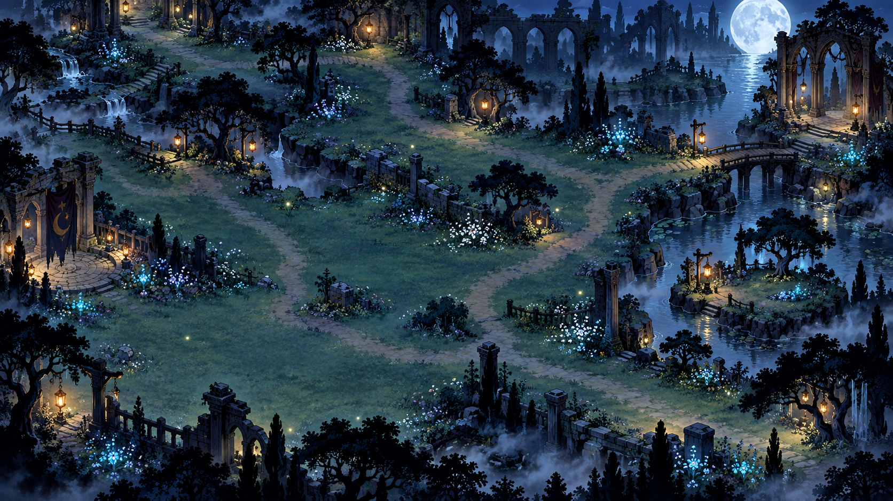
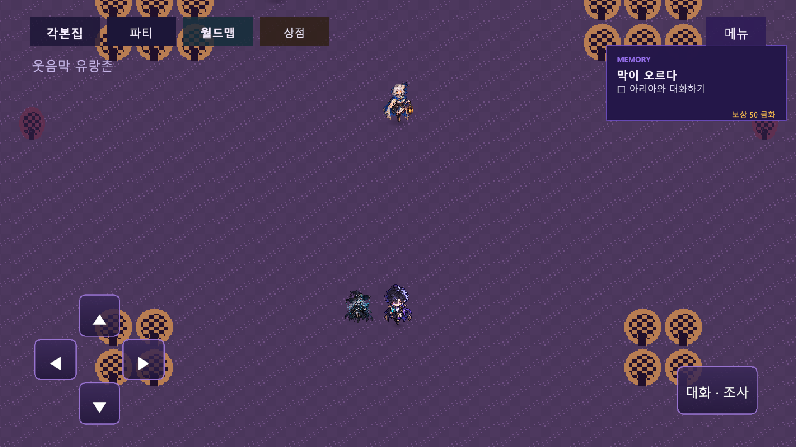
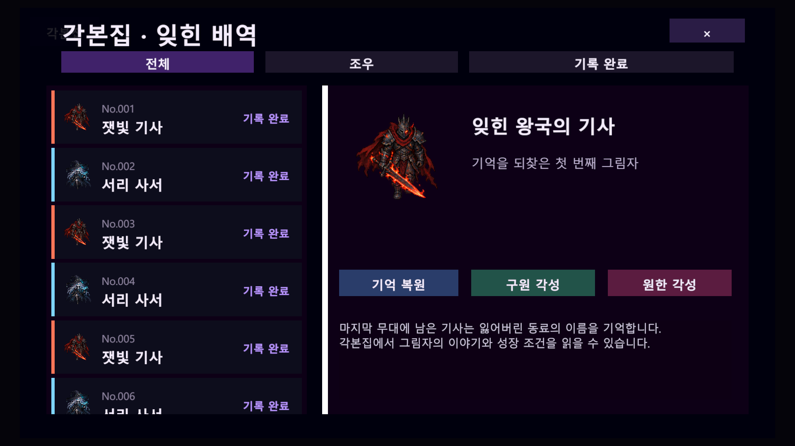
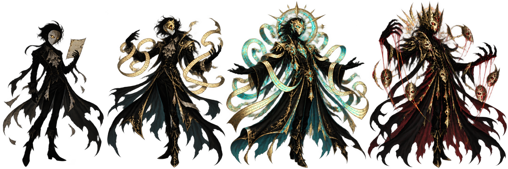
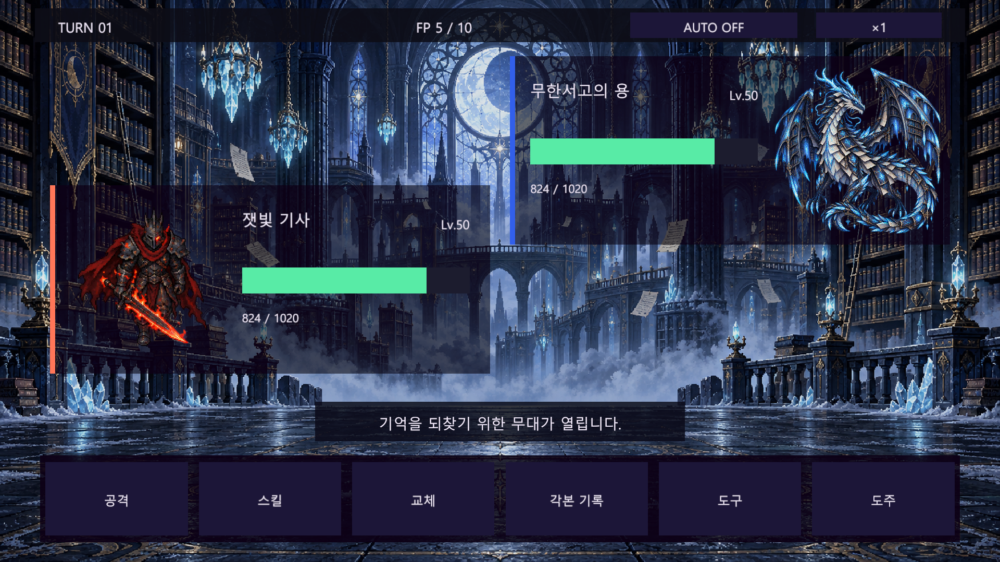

# 그림자 극장 잔영 — 게임 종합 소개

> **Shadow Theater: Afterimage** 
> 멸망한 세계에 남은 그림자의 기억을 수집하고, 비극의 결말을 다시 연출하는 스토리 중심 2D 모바일·PC RPG

이 문서는 2026년 10월 22일 현재 구현을 기준으로 게임의 세계관, 핵심 플레이, 콘텐츠와 시스템을 한곳에 정리한 종합 소개서다. 문서의 이미지는 현재 저장소에 포함된 콘셉트 아트와 개발 프리뷰이며, 실제 빌드에서는 기기 화면비와 생성된 씬 상태에 따라 구성이 달라질 수 있다.

---

## 한눈에 보기

| 항목 | 내용 |
|---|---|
| 장르 | 스토리 중심 2D 필드 탐험 + 그림자 수집형 턴제 RPG |
| 플랫폼 | Android·iOS 터치 UI와 Windows 키보드·마우스·게임패드 UI 동시 지원 |
| 엔진 | Unity 2022.3.52f3 LTS, URP 2D |
| 플레이 구조 | 필드 탐험 → 이야기와 의뢰 → 그림자 조우 → 턴제 전투 → 기록·성장 → 다음 지역 발견 |
| 세계 규모 | 8막, 63개 지역, 7개 극단 마을, 숨은 지역과 보스 무대 |
| 수집 규모 | 최대 180종 그림자, 각본집 기록과 수집 이정표 |
| 전투 | FP 자원을 사용하는 1대1 중심 전투, 교체·도구·기록·도주 |
| 성장 | 잔영 → 기억 복원 → 진명 각성, 구원/원한 분기 |
| 결말 | 누적 태도·마지막 선택·이전 회차에 따른 6종 엔딩과 동적 후일담 |
| 저장 | 위치·파티·도감·퀘스트·선택·탐험 상태를 JSON으로 저장, 백업 복구 지원 |

## 게임의 정체성

세상이 멸망한 뒤 사람과 영웅은 온전한 형체가 아니라 **그림자와 기억**으로 남았다. 플레이어는 잊힌 기록을 담는 `각본집`을 지닌 극단주가 되어, 여러 극단의 생활권을 여행하며 그림자들의 비극을 발견한다.

전투에서 약해진 그림자를 쓰러뜨리는 것만이 목적은 아니다. 각본집에 기록해 동료로 맞이하고, 잃어버린 과거를 복원하며, 끝내 그 기억을 **구원할지 원한으로 되살릴지** 선택한다. 그 과정에서 보인 연민, 보존, 통제의 태도는 마지막 무대의 결말을 바꾼다.

게임은 높은 그래픽 사양보다 다음 감각을 중요하게 다룬다.

- 캐릭터와 동행자가 실제 세계를 함께 걷는 듯한 움직임
- 풀, 물, 눈, 재, 날씨가 발걸음에 반응하는 필드
- 주민이 시간에 따라 생활하고 마을이 조금씩 회복되는 느낌
- 전투 밖에서도 발견과 기록이 계속 쌓이는 여행
- 휴대용 RPG처럼 명확하고 손에 잡히는 메뉴와 버튼

## 핵심 플레이 순환

1. 마을에서 주민과 대화하고 파티, 도구, 다음 목적지를 정비한다.
2. 필드로 나가 갈림길, 명소, 생태, 채집 지점과 숨은 입구를 탐색한다.
3. 야생 그림자 또는 이야기 속 적과 조우해 턴제 전투를 진행한다.
4. 상대의 체력을 낮추고 각본 기록에 성공하면 새로운 그림자가 동료가 된다.
5. 그림자의 기억과 개인 비극을 복원하고 구원 또는 원한의 진명으로 성장시킨다.
6. 지역 보스를 정화하고 다음 생활권을 열어 세계 멸망의 진실에 가까워진다.
7. 플레이 중의 선택과 수집·탐험 결과가 최종 무대와 엔딩에 반영된다.

## 세계와 이야기

### 주인공과 세력

- **극단주인 플레이어**: 각본집으로 그림자의 기억을 기록하고 다시 무대에 올린다.
- **동행 그림자**: 필드에서 플레이어의 실제 발자국을 따라다니며 탐험과 전투에 작은 패시브를 제공한다.
- **또 다른 연출가**: 그림자의 원한과 증오를 힘으로 이용하는 라이벌이다.
- **검은 검열단**: 고통스러운 기억은 없어져야 한다고 믿으며 기억과 그림자를 지우려 한다.
- **일곱 극단 마을의 주민들**: 서로 다른 공연 문화와 생활 방식을 지키며 세계의 회복을 보여 준다.

### 여덟 막의 여정

| 막 | 중심 무대와 주제 |
|---:|---|
| 1막 | 잔향 극장과 달빛 초원 — 각본집, 첫 동료와 정화의 의미를 배운다. |
| 2막 | 재의 왕관 — 멸망한 왕국과 남겨진 충성, 재의 왕을 둘러싼 기억을 좇는다. |
| 3막 | 금단의 서고 — 금지된 지식과 기억을 보존할 책임을 마주한다. |
| 4막 | 짐승의 밤 — 인간성과 본능, 두려움에 삼켜진 존재들을 다룬다. |
| 5막 | 인형 도시 — 통제와 자유, 누군가의 각본대로 움직이는 삶을 묻는다. |
| 6막 | 검은 검열단 — 기억을 지우려는 세력과 정면으로 충돌한다. |
| 7막 | 기억의 바다 — 잃어버린 기억과 미망인의 진실을 되찾는다. |
| 8막 | 마지막 극장 — 최초의 배우, 마지막 관객, 라이벌과 함께 최후의 결정을 내린다. |

### 분기와 엔딩

NPC 대화, 보스 앞의 선택, 그림자의 기억을 대하는 태도는 누적 성향으로 기록된다. 마지막 무대에서는 이 결과와 최종 선택이 여섯 가지 엔딩으로 이어진다. 결말은 회차·동행 그림자·복구한 마을·진명 수집량을 포함한 후일담으로 남고, 잠긴 결말은 조건을 암시하는 단서를 보여 준다. 기본 결말을 여러 회차에 걸쳐 기록하면 `모든 이름의 커튼콜`이 열린다.

## 필드 탐험

### 63개 지역과 순환형 월드맵

전체 세계는 7개 극단 생활권과 63개 지역으로 구성된다. 본선만 따라가는 일직선 지도가 아니라 우회로, 본선으로 다시 합류하는 순환로, 막다른 탐험 가지, 조건부 숨은 입구와 숨은 보스 무대가 연결된다.

- 처음 방문한 지역만 이름, 환경, 권장 레벨과 출현 그림자 정보가 공개된다.
- 방문한 극단 마을과 7막 유리 해안/8막 뒤집힌 로비의 보급 거점으로 빠른 이동이 열린다.
- 숨은 지역은 인접 지역을 열었다는 이유만으로 노출되지 않는다.
- 주민의 소문을 들으면 정답 대신 환경 단서가 월드맵에 `?`로 표시된다.
- 5·10·20·35·50·63개 지역 방문 시 누적 탐험 보상을 받는다.
- 지역별 명소, 생태, 길 복구, 실내 방문과 비밀 통로 발견 상태가 영구 기록된다.

### 살아 있는 이동

플레이어 캐릭터는 한 장의 그림이 떠다니는 방식이 아니라 방향별 보행 프레임, 가속감, 대기 몸짓과 지형 반응으로 이동감을 전달한다.

- 이동 중 들어온 다음 방향을 기억해 코너에서 입력이 끊기지 않는다.
- 가상 패드의 미세한 대각선 흔들림에는 직전 우세 방향을 유지한다.
- 같은 방향을 계속 누르면 자연스럽게 달리기 속도가 붙는다.
- 진흙은 느려지고 얼음은 관성이 생기며, 바람·사다리·낮은 턱은 각자 다른 이동 규칙을 가진다.
- 달릴 때 카메라가 조금 넓어지고, 벽에 닿거나 조사할 때 짧은 반응이 생긴다.
- 화면 Y좌표에 따라 캐릭터, 주민, 소품의 앞뒤 순서가 자연스럽게 바뀐다.

### 동행 그림자와 NPC

동행 그림자는 플레이어 좌표에 줄처럼 끌려오지 않는다. 플레이어가 실제로 밟은 안전한 칸을 독립된 대기열로 따라오고, 방향 전환과 거리 변화에 맞춰 속도를 조절한다. 정지 중에는 주변 NPC와 조사물을 바라보거나 호기심 몸짓을 보이며, 유대가 높을수록 가까이 머문다.

NPC도 같은 두 점을 기계적으로 왕복하지 않는다. 새벽, 낮, 저녁, 밤과 날씨에 따라 집·장터·귀갓길·처마로 목적지를 바꾸고, 플레이어가 다가오면 걸음을 멈추고 얼굴을 돌린다. 주민끼리 마주치면 짧게 인사하고 머리 위 생활 대사를 나눈다.

### 반응하는 환경

| 환경 | 이동 반응 |
|---|---|
| 풀숲 | 앞·뒤 잎 레이어가 진행 반대 방향으로 갈라졌다가 복원된다. |
| 물 | 출발 지점 물살과 착지 지점의 이중 파문이 남는다. |
| 눈·재 | 짧게 퍼졌다가 사라지는 발자국이 생긴다. |
| 비 | 일반 바닥에도 작은 물웅덩이 파문이 생긴다. |
| 꽃·나뭇잎 | 가까운 발걸음의 반대 방향으로 흔들린다. |
| 등불·깃발 | 빛, 바람, 날씨와 시간대에 맞춰 반응한다. |

이 반응은 플레이어뿐 아니라 동행 그림자와 야생 심볼에도 적용된다. 필드에는 새, 굴러가는 잎, 물고기 파문과 작은 반짝임이 드물게 나타나며, 물가에 가까워질수록 환경음이 부드럽게 커진다.

### 비전투 탐험 콘텐츠

- 지역별로 한 번 기록하는 고유 풍경점과 탐험 추억
- 하루에 한 번 다시 자라는 연고·토닉·잉크 채집 지점
- 물가 생물, 곤충, 새, 식생을 기록하는 생태 관찰
- 레버를 조작해 잔해나 끊어진 길을 영구 복구하는 환경 퍼즐
- 상자를 한 칸씩 밀어 길을 만드는 간단한 공간 퍼즐
- 던전과 숨은 지역에서 발견하는 영구 양방향 비밀 통로
- 가까운 미발견 명소나 출구 방향을 알려 주는 현장 길잡이
- 모닥불 휴식, 파티 회복과 실제 시간대 진행
- 명소·생태·복구·실내·비밀길·주민 호감을 모아 보는 탐험 수첩

## 마을 생활

일곱 마을은 상점과 회복 버튼만 있는 허브가 아니라 각 극단의 생활이 보이는 공간이다.

| 마을 | 성격 |
|---|---|
| 웃음막 유랑촌 | 광대 극단과 여정의 출발점 |
| 대학로 극단 거리 | 소극장과 배우가 모이는 공연 거리 |
| 물결막 수상극 항구 | 배와 수상 이동의 거점 |
| 등불막 그림자촌 | 빛과 장막으로 기억을 비추는 마을 |
| 달가면 산촌 | 전통 가면극과 산신 의식의 마을 |
| 실타래 인형극 공방촌 | 인형과 태엽 장치를 만드는 공방 지대 |
| 별노래 오페라 성도 | 공연 열차와 대극장이 있는 마지막 대도시 |

마을에는 집과 출입문, 우물, 장터, 게시판, 벤치, 화단, 골목 등불이 배치된다. 문을 조사하면 설명만 나타나는 것이 아니라 침대와 탁자가 있는 작은 실내로 직접 들어간다. 밤에는 등불이 밝아지고 장터가 정리되며, 악천후에는 주민이 처마와 집 쪽으로 이동한다.

주민은 하루마다 필요한 도구를 부탁한다. 부탁을 해결하면 금화, 마을 활동도와 누적 호감도가 오르며 마을의 회복을 체감할 수 있다. 벤치에서는 하루 한 번 파티를 회복하고 잠시 시간을 보낼 수 있다.

## 그림자 수집과 성장

### 각본 기록

야생 그림자의 체력을 낮춘 뒤 `각본 기록`을 선택하면 수집을 시도한다. 성공한 그림자는 빈 파티 슬롯으로 들어가고, 파티가 가득 찼다면 각본 서고로 이동한다. 일반 조우뿐 아니라 정화한 지역·전설 보스도 보상 그림자로 합류할 수 있다.

각본집은 단순 도감이 아니다. 그림자의 번호, 이름, 희귀도, 역할, 속성, 비극의 이야기와 성장 조건을 확인하는 기록 보관소다. 서로 다른 그림자 5·15·30·60·100·150·180종을 기록할 때 금화와 특수 잉크 보상을 받는다.

### 기억 성장

그림자의 성장은 단순한 외형 진화가 아니라 기억을 되찾는 과정이다.

1. **잔영** — 기억과 이름을 잃은 최초 형태
2. **기억 복원** — 개인 비극과 진실을 되찾은 형태
3. **구원 진명** — 상처를 받아들이고 새로운 의미를 선택한 각성
4. **원한 진명** — 비극과 분노를 힘으로 붙잡은 각성

형태마다 실루엣, 능력치 배율, 기술과 해금되는 이야기가 달라진다. 특히 지역 보스와 전설 그림자는 구원과 원한 형태가 전투 역할까지 크게 달라지는 전용 성장 구조를 갖는다.

전투 참여자는 배역 숙련도를 얻고, 숙련 20부터 공격·수호·속도 연기 중 성장 방향을 선택한다. 대기 그림자도 승리 경험치를 일부 받는다. 이미 기록한 종을 다시 기록하면 `기억 조각`으로 환원되며, 이 조각으로 성장 방향을 재조정할 수 있다. `기억의 연습 대본`은 필드에서 원하는 그림자에게 직접 경험치를 준다.

## 전투

전투는 그림자 한 명이 전면에 나서는 턴제 대결을 중심으로 한다. 공격 순서와 상태를 읽고, `공연 열기(FP)`를 모아 기술을 사용하는 구조다.

| 행동 | 역할 |
|---|---|
| 공격 | 기본 피해를 주고 FP를 만든다. |
| 스킬 | FP를 소비해 속성 공격, 회복, 강화와 상태 이상을 사용한다. |
| 교체 | 파티의 다른 그림자를 전면으로 내보내며 한 턴을 사용한다. |
| 각본 기록 | 약해진 기록 가능 그림자를 동료로 만들려고 시도한다. |
| 도구 | 회복 시약, 열기 토닉, 잉크와 정화 도구를 사용한다. |
| 도주 | 허용된 일반 전투에서 이탈을 시도한다. |

적 AI는 공격형, 교란형, 수호형 역할에 따라 행동한다. 보스는 체력이 낮아지면 고유 대사와 컷인, 색상 섬광, 화면 진동과 함께 2페이즈에 진입하고 FP·회복·정화·상태 이상 조합을 바꾼다.

필드의 시간과 날씨는 전투에도 이어진다. 3턴마다 비는 불꽃을 누르고, 눈은 발을 묶고, 재·안개·먹물 폭풍·달바람·실먼지·별비는 속성과 희귀도에 따라 상태, FP, 회복을 변화시킨다. 승리 후 공연 평가는 C~S 등급과 보너스 금화 외에도 누적 피해·회복·막내림을 비교해 `오늘의 배역`과 `결정적 장면`을 결과창에 남긴다.

전투 결과는 경험치와 금화에 그치지 않는다. 그림자의 역할과 희귀도에 따라 회복 시약, 토닉, 기록용 잉크, 정화 연고가 떨어지며 전설 그림자는 더 높은 확률로 특수 잉크를 남긴다.

## 파티, 유대와 도구

- 파티와 각본 서고 사이에서 보유 그림자를 이동하고 출전 순서를 변경한다.
- 지정한 동행 그림자의 속성은 탐험·조우·회복에, 역할은 공격·방어·속도·치명타·회피·기록률에 작은 패시브를 준다.
- 함께 걷고 풍경을 기록하거나 지역을 처음 발견하면 동행 유대가 오른다.
- 도구 가방에서 수량과 사용 가능 여부를 확인하고 대상 그림자를 골라 직접 사용한다.
- HP가 가득 찼거나 기절한 대상, 해제할 상태가 없는 상황처럼 낭비되는 사용은 버튼 단계에서 막는다.
- 상점은 막 진행도에 따라 새로운 회복제, FP 도구와 고급 기록 잉크를 해금한다.
- 마을별로 고무보트, 은빛 잉크처럼 생활권 특색이 있는 전문 상품을 판매한다.

## 시간, 날씨와 세계 상태

누적 플레이 시간을 기준으로 새벽, 낮, 해질녘, 밤이 순환한다. 날씨는 현실 시계의 우연한 값이 아니라 지역과 게임 내 날짜로 결정되므로 같은 저장 상태에서는 일관되게 재현된다.

시간과 날씨는 다음 요소에 실제 영향을 준다.

- 필드 조명, 등불, 장터와 주민 생활 동선
- 지역 입장 카드, 메뉴와 월드맵 환경 정보
- 그림자 출현 비중과 조우율
- 한 칸 이동 시간과 필드 회복 효율
- 생태 관찰 문구와 고유 풍경 기록
- 희귀 그림자 조우 전의 환경 전조

모닥불, 벤치와 일부 휴식은 파티만 회복하는 것이 아니라 세계 시간을 실제로 진행시킨다.

## 사운드와 장소감

29개 지역 테마의 지속·간헐 환경음, 8개 지형의 32개 발걸음, 일반 기술과 필살기 타격음, 13개 적응형 BGM 큐가 필드·전투·엔딩을 나눈다. 물가에 가까워지면 파도 소리가 커지고, 집 안에서는 밖의 환경음이 벽 넘어의 먹먹한 소리로 줄어든다. 장면 전환은 화면과 음악을 함께 교차 페이드하며, 음원 자산이 없을 때는 런타임 합성음으로 플레이 공백을 막는다.

## UI와 조작 경험

UI는 작은 모바일 화면과 PC의 넓은 화면 모두에서 현재 행동과 다음 목적을 즉시 찾을 수 있는 휴대용 RPG 감각을 목표로 한다.

- 필드 상단에서 각본집, 파티, 월드맵, 상점과 메뉴에 바로 접근한다.
- 모바일 방향키와 조사 버튼, PC 키보드·마우스·일반 게임패드를 함께 지원한다.
- PC에서는 터치 전용 조작부를 숨기고 단축키 안내를 표시하며 전체 화면, 해상도와 수직 동기화를 저장한다.
- Android 뒤로가기와 Escape는 현재 열린 화면을 먼저 닫고, 열린 화면이 없을 때 필드 메뉴를 연다.
- 퀘스트 HUD는 현재 목표와 실제 지급 보상을 함께 보여 준다.
- 도구 획득, 저장, 지역 발견과 퀘스트 완료는 별도의 짧은 피드백으로 전달한다.
- 메뉴의 `여정 브리핑`은 탐험, 수집, 퀘스트와 엔딩을 합산해 전체 완성도와 다음 행동을 추천한다.
- 필드에서는 상호작용 가능한 대상 위에 문맥 표식과 은은한 강조가 나타난다.
- 카메라와 진동 피드백은 설정을 따르며 대화·조사·조우의 초점을 분명하게 만든다.

## 퀘스트와 장기 진행

메인 퀘스트는 NPC 대화, 지역 방문, 그림자 기록과 보스 정화를 하나의 이야기 흐름으로 연결한다. 완료 기록장에서는 이전 줄거리, 목표별 달성 상태, 보상 수령 여부를 다시 확인할 수 있다.

비전투 장기 목표도 함께 쌓인다.

- 63개 지역 방문과 숨은 입구 발견
- 180종 각본 기록 이정표
- 지역 풍경과 생태 수첩 완성
- 주민 부탁과 마을별 호감도
- 끊어진 길과 비밀 통로 복구
- 그림자 기억 복원과 진명 분기
- 여섯 가지 엔딩과 회차별 후일담 발견

## 저장과 안전장치

게임은 긴 여정에서 진행이 막히거나 사라지지 않도록 여러 복구 장치를 갖춘다.

- 지역 이동, 전투 결과와 퀘스트 진행 시 자동 저장
- 수동 저장과 저장 완료 피드백
- 주 저장 파일 손상 시 `.bak` 백업 복구
- 더 최신 버전 저장, 씬 누락과 손상 상태를 구분한 안내
- 저장 좌표가 새 벽이나 물, 맵 밖에 놓이면 가장 가까운 안전 타일로 보정
- 필드 경계를 벗어나면 마지막 안전 칸으로 즉시 복구
- 메뉴의 `안전 위치 복귀`로 체크포인트 또는 직전 거점 이동
- 보스 승리 대화 도중 종료해도 보상과 다음 지역 플래그 복구
- 구버전 저장에서 빠진 보유 그림자와 후속 퀘스트 자동 보정
- 실내에서 저장해도 다음 시작 위치는 야외 출입문 앞으로 보존

## 현재 콘텐츠 요약

| 분류 | 구현 내용 |
|---|---|
| 이야기 | 8막 장편 여정, 라이벌과 검열단, 누적 선택, 6종 엔딩과 후일담 |
| 세계 | 63개 지역, 7개 마을, 순환로·숨은 지역·보스 무대 |
| 수집 | 최대 180종 그림자, 각본집, 파티와 서고, 수집 이정표 |
| 성장 | 레벨, 기술, 숙련도·성장 방향, 대기 경험치, 기억 복원, 구원·원한 진명, 동행 유대 |
| 전투 | 1대1 턴제, FP, 교체, 도구, 기록, 날씨 기믹, 역할별 AI, 공연 평가, 보스 2페이즈 |
| 탐험 | 지형 반응, 시간·날씨, 명소, 채집, 생태, 퍼즐, 비밀 통로, 캠프 |
| 마을 | 시간대별 주민, 실내, 상점, 회복, 소문, 부탁과 호감도 |
| 사운드 | 13개 적응형 BGM, 29개 환경 테마, 32개 발걸음, 물가·실내 거리감 |
| 편의 | 월드맵, 브리핑, 퀘스트 기록, 가방, 설정, 빠른 이동, 안전 복귀 |
| 안정성 | 자동 저장, 백업 복구, 좌표 보정, 경계 복귀, 전체 회귀 검증 |

## 개발과 콘텐츠 생성

프로젝트는 1인 개발 규모에서도 많은 콘텐츠를 일관되게 관리할 수 있도록 데이터와 생성 도구 중심으로 구성된다.

- `ShadowData`, `SkillData`, `ItemData`는 전투와 수집 데이터를 관리한다.
- 대사, 퀘스트, 지역, 엔딩과 현지화 원본은 JSON으로 분리한다.
- 에디터 생성기가 핵심 데이터, 모바일·PC 반응형 UI, 64개 씬과 필드 콘텐츠를 구성한다.
- 회귀 검증기는 지역 연결, 포털 도착점, 이동 가능 타일, UI와 핵심 시스템 누락을 검사한다.
- 전투 밸런스 분석과 지역 난이도 시뮬레이션으로 스탯·기술·조우 분포를 점검한다.

프로젝트 설치와 생성 방법은 [`README.md`](../README.md), 월드 구조는 [`WORLD_MAP.md`](WORLD_MAP.md), 상세 개발 문서는 [`Docs`](.) 폴더에서 확인할 수 있다.

---

## 한 문장으로 정리하면

**《그림자 극장 잔영》은 멸망한 세계를 여행하며 비극으로 남은 그림자를 기록하고, 그 기억을 구원할지 원한으로 되살릴지 선택해 자신만의 마지막 공연을 완성하는 수집형 이야기 RPG다.**
